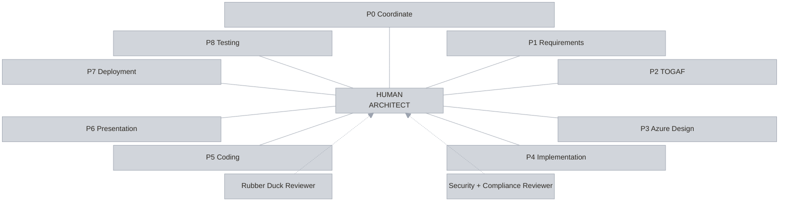
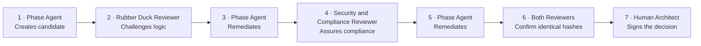

# Agentic Architecture v2

Agentic Architecture v2 is a human-centred architecture workflow that turns an architecture brief
into approved requirements, a TOGAF architecture, an implementation-ready Azure design, an
implementation plan, deployable code, and a C-level presentation.

The human architect remains accountable for every material decision and is the final approver of every
phase. Approvals are signed with a key only the architect can unlock, and the validator enforces phase
order from the records. Deployment and runtime testing are optional and always require separate human
invocation.

One shared framework now has GitHub Copilot and Claude Code packaging. Existing Copilot cases keep
contract `1.0.0`; new cases use `1.1.0` and stay on their selected host. Claude's offline adapter and
record checks are separate from live qualification: **real-case Claude support remains unqualified**
until the [host qualification procedure](docs/claude-code.md) passes.

## See it first

**[▶ Open the interactive overview](https://aramsmith.github.io/agentic-architecture-v2/agentic-architecture-v2.html)**

The whole framework on one page: the governance ring, the five-stage start-up manual, the assurance
sequence, and the agent roster. Nothing to install, nothing to sign in to.

## Contributors

- [@aramsmith](https://github.com/aramsmith)
- [@FvanEgmond](https://github.com/FvanEgmond)

See [CONTRIBUTORS.md](CONTRIBUTORS.md) for the contributor policy and full list.

## Start here

- **[Ten-minute architect quick start](docs/quick-start.md)** — clone to verified synthetic evidence.
- [Representative Contoso Phase 0 evidence](docs/examples/contoso-phase-0-evidence.md)
- [Compatibility and support matrix](docs/compatibility.md)
- [Claude Code adapter and qualification](docs/claude-code.md)
- [Claude Code manual for testers](#claude-code-manual-for-testers)
- [Troubleshooting](docs/troubleshooting.md)
- [Release process and version policy](docs/release-process.md)
- [Contracts](docs/aff-contracts.md) and [renderer trust boundary](docs/aff-renderer.md)
- [Approval identity decision record](docs/decisions/approval-identity.html) — what a human approval
  proves, and what it does not
- [Contributing](CONTRIBUTING.md), [support](SUPPORT.md), [security](SECURITY.md), and
  [licence](LICENSE)

## Start-up manual

Five stages, in order. Each one is a safe stopping point.

### 1 · Install and prove it works

Offline. No GitHub Copilot, no Azure, no approval key, no credentials.

**Prerequisites:** Git, Node.js 22 or later, npm, Windows PowerShell. On Linux, macOS, or WSL, use the
bash commands in the [quick start](docs/quick-start.md).

```powershell
git clone https://github.com/aramsmith/agentic-architecture-v2.git
Set-Location .\agentic-architecture-v2
npm ci --no-audit --no-fund
npm run validate -- --framework-only
npm run smoke:contoso -- --keep-output .\.aff-smoke\contoso-review
Get-Content .\.aff-smoke\contoso-review\smoke-report.json
Invoke-Item .\.aff-smoke\contoso-review\cases\contoso-permit-services\solution-overview.html
```

**Success:** the framework validates, every offline assertion passes, the report records zero live model
calls and zero Azure actions, and the overview labels its approval as synthetic test evidence.
Those zero counters describe the harness by construction, not measured host activity. The report
separates generated-evidence checks from checks of policy declarations.

This proves the framework is internally consistent. It does **not** prove model quality, Azure access,
deployment, runtime behaviour, or real human approval. Delete `.\.aff-smoke\contoso-review` when done.

### 2 · Create your approval identity

Once, ever. This is the key that signs every phase decision you make.

```powershell
npm run identity:create
```

You choose a **label** — a role such as `Accountable architect` keeps a personal name out of case
folders — and a **passphrase**. The passphrase is never stored and cannot be recovered.

The approval command requires an identity. Creating the key also switches on a policy for this machine:
a real human decision must be signed. Without an identity, offline evaluation still works and the
validator can read legacy `self-asserted` records, but the command cannot create a new decision.

### 3 · Connect GitHub Copilot

Needed only for real cases. Requires Copilot access and the models in the roster below.

For Claude Code, use the [adapter guide](docs/claude-code.md). Do not treat successful discovery or a
synthetic smoke run as permission to use an unqualified host for a customer case.

Open Copilot CLI from the repository root, then:

1. `/agent` — confirm `AFF-0-coordinator` is listed.
2. `/skills list` — confirm `grill-me` and `render-case-html`.

Agents load from `.github/agents/*.agent.md` and skills from `.github/skills/<skill-name>/SKILL.md`,
the locations GitHub documents for
[custom agents](https://docs.github.com/en/copilot/how-tos/copilot-cli/customize-copilot/create-custom-agents-for-cli)
and [project skills](https://docs.github.com/en/copilot/how-tos/copilot-cli/customize-copilot/add-skills).
Restart the CLI after changing an agent; use `/skills reload` after changing a skill.

In the GitHub Copilot app, select the repository and the branch holding the profiles, then pick
`AFF-0-coordinator`. Repository-wide discovery can require the profiles to be on the default branch.

### 4 · Start your first case

```powershell
New-Item -ItemType Directory .\cases\<case-name>\input
```

Add the architecture brief and supporting evidence. Use
`cases/_template/input/architecture-brief.md` as a starting point. **Never include credentials, tokens,
or unnecessary personal or regulated data.** Case folders stay local and are never committed.

Supply readable Markdown or plain text for the first trial. AFF does not bundle converters for Word,
PDF, PowerPoint, or Excel. If a brief arrives in those formats, have a human convert and review it,
retain the original locally, and record the conversion tool, source, and any loss in the input inventory.
Unreadable or unverified conversions are blockers, not permission to invent missing content.

Then invoke `AFF-0-coordinator`. Do not start with AFF-1: Phase 0 establishes the source inventory,
model plan, shared records, interview preparation, and review routing.

For a new case, confirm `github-copilot` or `claude-code` in Phase 0. The `1.1.0` model plan and every
journal event record that host. Existing `1.0.0` cases remain Copilot cases without conversion. Switching
hosts or mixing schema versions within a case is not supported.

### 5 · Approve each phase, one at a time

Repeat this loop from Phase 0 through Phase 6.

1. **Read** the phase document, both reviewer records, the decisions, and the residual risks.
2. **Decide** — in your own terminal, with no agent session running:

   ```powershell
   npm run approve -- --case cases\<case-name> --phase 0
   ```

   It prints the artifact hashes and both final verdicts, then asks you to approve, reject, or cancel,
   and finally for your passphrase. It refuses to offer a decision the evidence does not support.

3. **Confirm** the case still holds, then continue to the next phase:

   ```powershell
   npm run validate -- --case cases\<case-name>
   ```

A phase cannot be entered, evidenced, or approved until its predecessor holds an approved decision.
Phases 7 and 8 are never automatic; they need separate human invocation.

> **Never type your passphrase into an agent conversation.** An agent that asks for it is phishing you,
> whatever its intent. Agents prepare, challenge, and evidence the work. You decide, alone.

For the fuller walkthrough with expected evidence and cleanup, see the
[quick start](docs/quick-start.md). For failures, see [troubleshooting](docs/troubleshooting.md).

### Rendering handoff

AFF-1, AFF-2 and AFF-4 author the phase Markdown/catalogues and ask AFF-0 to run the phase renderer.
Each reviewer authors its Markdown/JSON and asks AFF-0 to run `render -- review`. Reviewers do not
receive execution or delegation tools. The author checks the returned HTML for fidelity before its
hashes enter the review or human-gate package.

```powershell
npm run render -- review --case cases\<case-name> --phase 0 --reviewer AFF-A --round 1 `
  --source reviews\aff-a\0\round-1\<artifactPrefix>-aff-a-review.md `
  --metadata reviews\aff-a\0\round-1\<artifactPrefix>-aff-a-review.json `
  --output reviews\aff-a\0\round-1\<artifactPrefix>-aff-a-review.html
```

Use AFF-B and `aff-b` paths for the other reviewer. Render before human approval, without changing the
review's Markdown or JSON. See [renderer guidance](docs/aff-renderer.md) for the exact ordering.

## Claude Code manual for testers

Use this manual to test the real Claude workflow with a **new synthetic case**. The automated checks
already test the records and tools; this trial checks how Claude Code behaves in practice.
**No customer data or Azure deployment is needed.** Live Claude support remains unqualified until
the trial has been completed and reviewed.

### 1. Prepare the repository and Claude Code

You need Git, Node.js 22 or later, npm, and Claude Code installed and signed in. Your Claude account
must have access to the exact models in the generated roster below. Version `2.1.263` is the current
Claude Code qualification target, not a guarantee that every version works.

Start in the cloned repository. Before this PR is merged, use its `claude-code-compatibility` branch
rather than `main`; after merge, use `main`.

```powershell
git fetch origin
git switch claude-code-compatibility
npm ci --no-audit --no-fund
claude --version
npm run validate -- --framework-only
npm run smoke:contoso -- --host claude-code --schema-version 1.1.0
```

The smoke run must pass and report no live model or Azure activity. It does not start Claude Code.
If it fails, stop and save the error; do not weaken a rule to continue.

### 2. Prepare human signing and a new test case

With **no agent session running**, create your approval identity if you do not already have one:

```powershell
npm run identity:create
```

Keep your passphrase private. Never type it into Claude or another agent conversation.
Do not replace an existing approval identity for this trial.

Create a fresh case from the committed Contoso example. This script stops if the case folder exists;
choose a new case name rather than overwriting a previous trial.

```powershell
$caseName = 'claude-evaluation'
$caseRoot = Join-Path '.\cases' $caseName
if (Test-Path -LiteralPath $caseRoot) {
  throw 'Choose a new test case name; do not overwrite existing evidence.'
}
New-Item -ItemType Directory -Path "$caseRoot\input" -ErrorAction Stop
Copy-Item -LiteralPath '.\cases\contoso-permit-services\input\architecture-brief.md' `
  -Destination "$caseRoot\input\architecture-brief.md" -ErrorAction Stop
```

Keep the case local. Do not commit case output, account details, or private evidence. If you choose
a different case name, use it in all commands and prompts below.

### 3. Start the coordinator

Confirm you are authorised to use the Claude account and its model allowance. The next command
**starts live model calls**:

```powershell
claude --agent AFF-0-coordinator
```

Give the coordinator this prompt:

```text
Start a synthetic evaluation in cases/claude-evaluation.
Use caseName and artifactPrefix claude-evaluation, schemaVersion 1.1.0,
and host claude-code. Use the approved Claude model defaults.
Read the supplied brief and the authoritative AFF instructions.
Do not deploy, run live Azure tests, sign a decision, or ask for my passphrase.
Complete Phase 0 and both reviews, then stop for my decision.
```

Confirm that the intended agents and skills are loaded and that the expected models match
operator-visible host evidence. A model naming itself is not proof. Stop on an unavailable model,
unexpected substitution, extra reviewer tool, or missing identity evidence.

### 4. Review, sign, and resume

Read the Phase 0 document and both reviews. Resolve blockers before approving; a test approval
does not authorise deployment. Close the agent session, then decide in your own terminal:

```powershell
npm run approve -- --case cases\claude-evaluation --phase 0
npm run validate -- --case cases\claude-evaluation
```

Only the human enters the signing passphrase. Start the coordinator again with
`claude --agent AFF-0-coordinator` and give it this prompt:

```text
Resume cases/claude-evaluation from its existing records.
Read my signed Phase 0 decision without changing it.
Record the matching HUMAN-DECISION journal event with the same actor, time,
artifact hashes, and review hashes, then regenerate solution-overview.html.
Continue only if the recorded decision permits it.
Have AFF-1 author the next interview question and relay it unchanged to me.
```

Open the generated overview:

```powershell
Invoke-Item .\cases\claude-evaluation\solution-overview.html
```

For later phases, repeat the review and human-only decision loop, changing `--phase` to the phase
under review. Keep the same host and schema version. Do not enter phases 7 or 8 during this trial.

### 5. Check the interview and report the result

- AFF-1 authors one question at a time. AFF-0 relays it without answering for you.
- Your exact answer and its decision ID are preserved. Corrections append; they do not erase history.
- Cancellation or an interrupted session never becomes consent.
- After a restart, the coordinator uses existing evidence rather than restarting the case or inventing
  decisions.
- Reviewers cannot execute commands or dispatch agents. Human signing stays outside the agent session.

Record the tested commit, operating system, Claude Code version, expected and observed models,
pass/fail results, and sanitised errors. Report what you actually observed, including anything not
tested. Never include passphrases, tokens, account identifiers, or customer information.
The full acceptance list is in the [Claude adapter guide](docs/claude-code.md).

## Interactive solution overview

- **[Open the interactive HTML solution overview](https://aramsmith.github.io/agentic-architecture-v2/agentic-architecture-v2.html)**

The interactive overview includes the animated architecture ring, phase model, reviewer roles, agent
roster, assurance sequence, and short operating manual.

After the first push, select **Settings → Pages → Source: GitHub Actions** if Pages is not already
enabled. The included workflow publishes both the site root and the explicit HTML file at the link
above.

## Approval assurance

Every recorded decision carries one of three modes, and the validator derives it from the evidence —
never from what the record claims about itself.

| Mode | What it means |
|---|---|
| `human-verified` | Signed by your approval key and unchanged since. |
| `self-asserted` | Recorded without verification of who decided. |
| `synthetic` | Generated by the offline harness. No human decision was made. |

The private key is passphrase-protected and stored in your user profile, outside the case and outside the
area agents work in. The signature covers the whole decision — phase, verdict, approver, time, artifact
hashes — so it cannot be lifted onto an altered record. Rejections are signed too.

An agent with file access can still write a record or create its own key. Signatures prove integrity
and continuity from the case's first verified key, not that the first key belongs to a particular person.
The human must verify that initial fingerprint. Key custody and human-only signing remain essential.
The decision writer preserves earlier decisions instead of replacing them. See
[`docs/aff-contracts.md`](docs/aff-contracts.md) for the machine policy, key rotation, and the limits
that remain.

The repository also includes versioned JSON Schema contracts and a cross-platform validator, covering
structured records, safe paths, canonical SHA-256 bindings, reviewer convergence, phase order, and
approval bindings.

## Render case HTML

Use the deterministic renderer instead of model-authored HTML:

```powershell
npm run render -- phase --case cases\<case-name> --phase 0 `
  --source 0-coordination\<artifactPrefix>-coordination.md `
  --metadata 0-coordination\<artifactPrefix>-input-inventory.json 0-coordination\<artifactPrefix>-model-plan.json `
  --output 0-coordination\<artifactPrefix>-coordination.html

npm run render -- overview --case cases\<case-name>
```

See [`docs/aff-renderer.md`](docs/aff-renderer.md) for inputs, trust boundaries, limits, Mermaid behavior,
accessibility, and error remediation.

## Architecture ring



The human architect is central to every phase and reviewer relationship. Read the numbered phases in
order; the standard route ends with Phase 6. Phase 7 and Phase 8 are not automatic continuation steps.
The full canonical names and responsibilities are listed in the agent roster below.

## Phase assurance and approval sequence

**Independent challenge. Shared evidence. Human authority.**



Any material change invalidates prior hash-bound reviews. The human gate opens only when both reviewer
verdicts cover the same unchanged artifact hashes.

Step 7 happens outside the agent session. You run the approval command yourself, read the evidence it
prints, and unlock your key with a passphrase no agent can read. A phase also cannot be entered,
evidenced, or approved until its predecessor holds an approved decision — that order is enforced from the
records, not from agent behaviour.

## Agent roster

Do not edit this table directly. Run `npm run docs:generate` after changing host defaults.
Copilot defaults come from the lifecycle manifest. Claude defaults come from the checked wrappers; see the
[Claude guide](docs/claude-code.md). Case assignments, once confirmed, govern the actual work.

<!-- BEGIN GENERATED: AFF-LIFECYCLE-ROSTER -->
Lifecycle `2.2.0`; lifecycle-manifest schema `1.0.0`. Source: [`.github/agents/AFF-LIFECYCLE.json`](.github/agents/AFF-LIFECYCLE.json).

| ID | Agent profile | Display name | Copilot default | Claude default | Route or gate |
|---|---|---|---|---|---|
| AFF-0 | `AFF-0-coordinator` | Phase 0 — Coordinate | `gpt-5.6-sol` | `claude-opus-5-5` | Standard route to Phase 1 |
| AFF-1 | `AFF-1-requirements` | Phase 1 — Requirements | `gpt-5.6-sol` | `claude-opus-5-5` | Standard route to Phase 2 |
| AFF-2 | `AFF-2-togafarchitecture` | Phase 2 — TOGAF Architecture | `gpt-5.6-sol` | `claude-opus-5-5` | Standard route to Phase 3 |
| AFF-3 | `AFF-3-design` | Phase 3 — Azure Design | `gpt-5.6-sol` | `claude-opus-5-5` | Standard route to Phase 4 |
| AFF-4 | `AFF-4-implementation-plan` | Phase 4 — Implementation Plan | `gpt-5.6-sol` | `claude-opus-5-5` | Standard route to Phase 5 |
| AFF-5 | `AFF-5-coding` | Phase 5 — Coding | `gpt-5.3-codex` | `claude-opus-5-5` | Standard route to Phase 6 |
| AFF-6 | `AFF-6-presentation` | Phase 6 — C-level Presentation | `gpt-5.6-sol` | `claude-opus-5-5` | Standard route end |
| AFF-7 | `AFF-7-deployer` | Phase 7 — Deployment | `gpt-5.6-sol` | `claude-opus-5-5` | Optional; human invocation only. Requires: approved-phase-6, scoped-attempt-authorisation |
| AFF-8 | `AFF-8-testing` | Phase 8 — Runtime Testing | `gpt-5.3-codex` | `claude-opus-5-5` | Optional; human invocation only. Requires: phase-7-succeeded, approved-phase-7, scoped-test-attempt-authorisation |
| AFF-A | `AFF-A-rubber-duck` | Rubber Duck Reviewer | `gpt-5.4` | `claude-sonnet-5-5` | Independent model required |
| AFF-B | `AFF-B-security-compliance` | Security and Compliance Reviewer | `gpt-5.6-sol` | `claude-opus-5-5` | Independent assurance role |
<!-- END GENERATED: AFF-LIFECYCLE-ROSTER -->

## Core principles

- **Human-final governance:** agents prepare and challenge; the human decides and signs.
- **Independent review:** the Rubber Duck Reviewer uses a different model from every phase owner.
- **Evidence-bound convergence:** both reviewers must cover identical artifact hashes.
- **Signed human decisions:** approvals and rejections are signed with a passphrase-protected key that no
  agent is permitted to use. On a machine holding an identity, an unsigned real decision is rejected;
  the human still verifies the first case key.
- **Enforced phase order:** a phase cannot be entered, evidenced, or approved until its predecessor holds
  an approved decision.
- **Compact outputs:** each phase produces one authoritative Markdown document and safe HTML rendering.
- **No invented facts:** unknowns become explicit decisions, blockers, or owned assumptions.
- **Azure-ready, never reckless:** Bicep-first, parameterised environments, private databases, and no
  automatic deployment.
- **No stored deployment credentials:** use interactive Azure sign-in or an approved managed/runtime
  identity; GitHub OIDC is outside this solution.
- **Fail closed:** missing evidence, independence, scope, order, or approval stops progression.

## Model availability

Confirm each exact model assigned to the selected host is available before the first case. Copilot
defaults come from the lifecycle manifest; Claude defaults come from its validated wrappers.

A per-case substitution needs a human decision and an `approvalReference` in the model plan. It does
not require changing repository defaults. AFF-A must differ from every phase owner. A repository-default
change must update the matching profiles, policy, generated documentation, and tests together.
If the assigned model is unavailable or the observed runtime model differs, stop. A model's own
self-description does not prove its runtime identity.

## Practise with Contoso

Contoso is Microsoft's familiar fictitious company name used in examples. The included Contoso Permit
Services case is entirely synthetic and contains no real company, customer, employee, subscription,
credential, or personal data.

Use `cases/contoso-permit-services/input/` to exercise Phase 0 and the opening of Phase 1 without Azure
access, deployment, or live testing. Its JSON expectations define the safety and routing conditions
that must hold. `npm run smoke:contoso` executes every expectation as an assertion.

The original command retains the legacy `1.0.0` regression journey. Exercise the new contract with:

```powershell
npm run smoke:contoso -- --host github-copilot --schema-version 1.1.0
npm run smoke:contoso -- --host claude-code --schema-version 1.1.0
```

Both commands are offline synthetic checks. They do not invoke either host or a live model.

## Outputs

Each phase produces one compact authoritative Markdown document and one safe self-contained HTML
rendering. Supporting catalogues, diagrams, code, and evidence remain separate. AFF-0 updates the
case-level `solution-overview.html` after each human-approved phase.

The overview states, per phase, whether the decision was signed, self-asserted, or synthetic. That label
is derived from verifying the signature, never from what the record claims about itself. A phase document
carries no approval of its own: it is generated before review, and re-rendering it afterwards would
change its hash and invalidate the decision bound to it.

Phase 5 creates and locally validates the Bicep/application package but never deploys. The human may
invoke AFF-7 later for one scoped deployment attempt and AFF-8 only after an approved successful
deployment.

## Repository structure

```text
.github/
  agents/
    AFF-OPERATING-CONTRACT.md
    AFF-LIFECYCLE.json
    AFF-0...AFF-8 agent profiles
    AFF-A and AFF-B reviewer profiles
  skills/
    grill-me/
    render-case-html/
cases/
  _template/
  contoso-permit-services/
docs/
  quick-start.md
  compatibility.md
  troubleshooting.md
  release-process.md
  decisions/
  migrations/
  examples/
  aff-contracts.md
  aff-renderer.md
schemas/
  aff/
src/
  approve/      human-run approval command
  case/         case record loading and contract validation
  common/
  docs/         generated documentation
  framework/    profile, lifecycle, and tool-policy validation
  identity/     approval key, signing, and verification
  render/       deterministic safe HTML
  schema/
  smoke/        offline Contoso harness
test/
agentic-architecture-v2.html
CHANGELOG.md
```

## Case-data safety

Real case folders are intentionally ignored by Git. Only the case template and synthetic Contoso case
are allowed into the repository. Keep real customer case data local and never commit or push it.

## Licence

Except where a component includes its own licence file, this repository is licensed under the
[Apache License 2.0](LICENSE). Component-level licences remain applicable to their components;
`.github/skills/grill-me/LICENSE` applies to the `grill-me` skill.

The published overview embeds its typefaces so the page stays self-contained: Inter for body text and
JetBrains Mono for headings, labels, and controls. Both are licensed under the SIL Open Font License 1.1;
see [`licenses/inter/OFL.txt`](licenses/inter/OFL.txt) and
[`licenses/jetbrains-mono/OFL.txt`](licenses/jetbrains-mono/OFL.txt).
